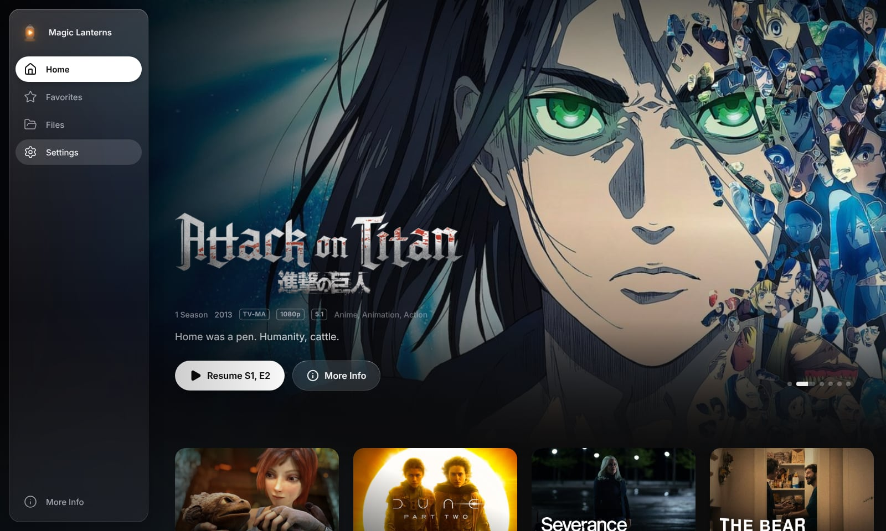
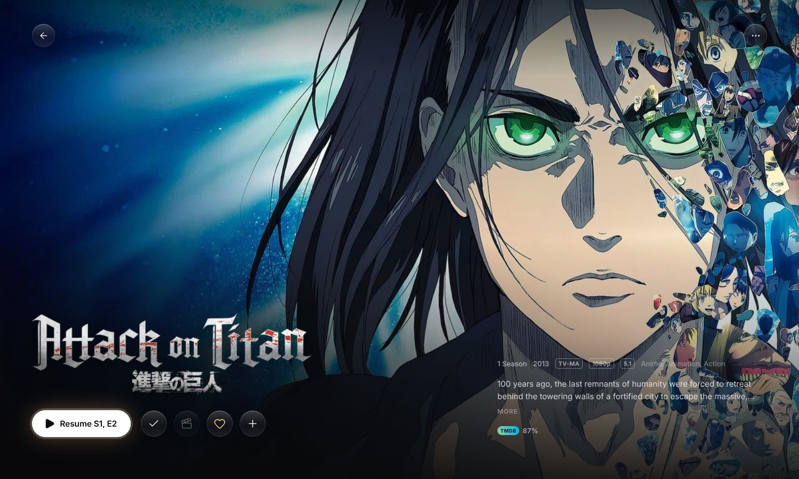
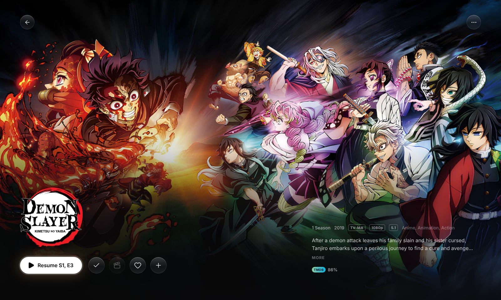
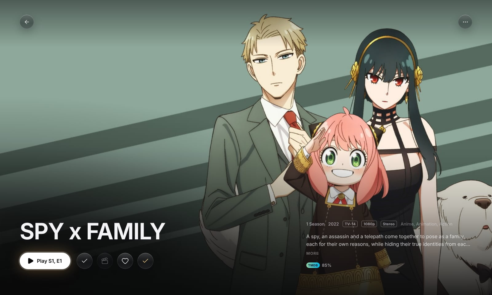
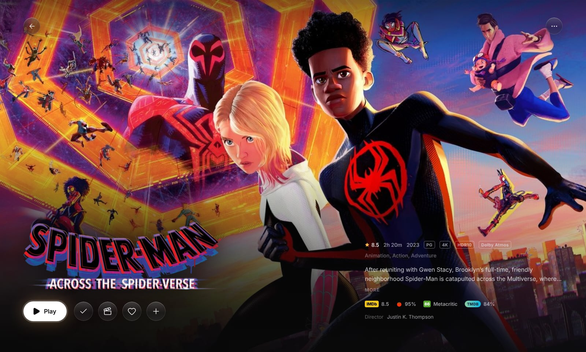
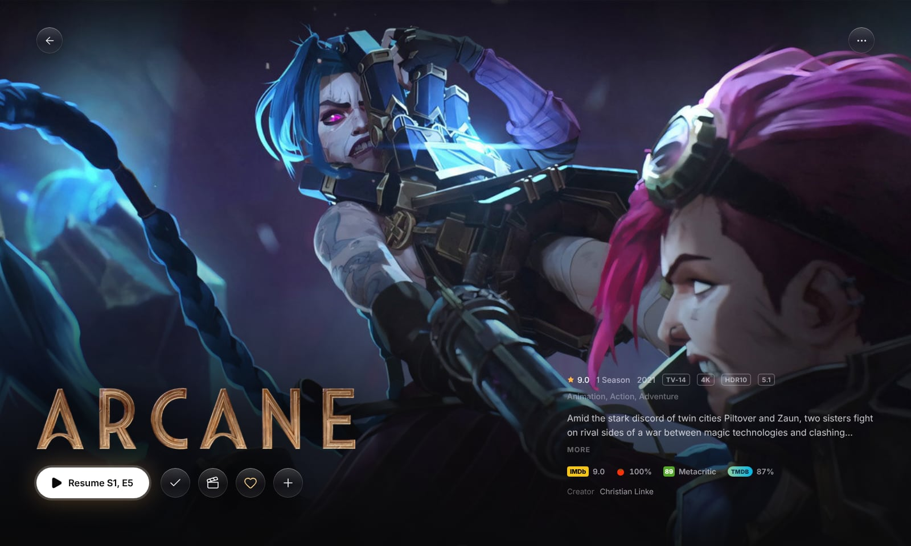
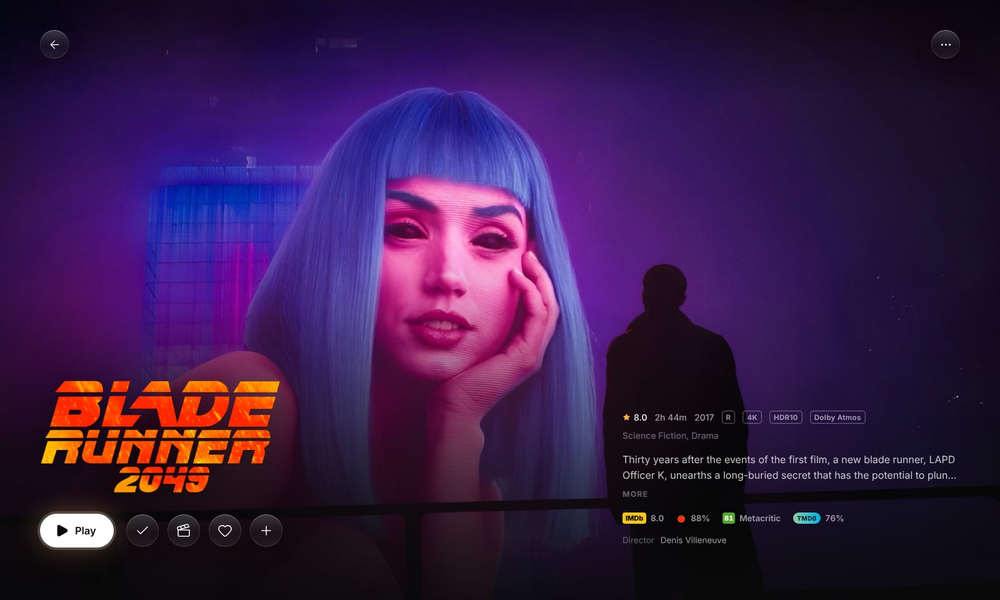
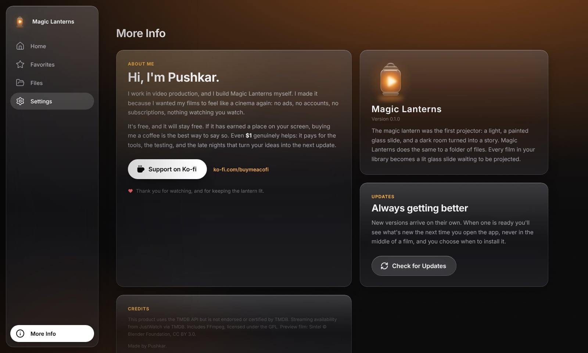

# Magic Lanterns

A premium local media player for Windows. Point it at your folders and it turns them into a cinematic library you browse with a remote, a keyboard or a mouse.

> The magic lantern was the first projector: a light, a painted glass slide, and a dark room turned into a story.
> Magic Lanterns does the same to a folder of files.


## Download (Windows 10 / 11)

**[⬇ Download MagicLanterns-Setup.exe](https://github.com/PushkarX-Code/MagicLanterns/releases/latest/download/MagicLanterns-Setup.exe)**, then run it.

Or install from PowerShell in one line:

```powershell
irm https://raw.githubusercontent.com/PushkarX-Code/MagicLanterns/main/install.ps1 | iex
```

This downloads the latest release and opens the installer. The app isn't code-signed yet, so Windows SmartScreen may say *"Windows protected your PC"*: click **More info → Run anyway**.

## Screenshots

Every screenshot is the running app. Artwork and details are real film data; the player is showing the open-licensed film *Sintel*.

**Every title gets a cinematic page**


**Anime, front and centre**








**Animation**


**Series, picking up where you left off**




**Home.** Recents, Recently Added, Picks of the Day


**Film Genres, Unwatched and Most Watched**


**The player**


**Favorites**


**Files**


**Light theme**


**More Info.** About the app, updates, and the person who makes it


## What's in it

**Sections:** Home, Favorites, Files and Settings, with **More Info** at the foot of the sidebar: what the app is, a Check for Updates button, and a note from me.

**Home** opens on a hero carousel, then: your recents (no heading, just the films), Recently Added, Picks of the Day (a fresh shuffle every day), Film Genres, Unwatched, Most Watched, and five rows about the wider world: **Top 10 This Week**, **Top 10 This Month**, **Greatest of All Time**, **Must-Watch Series** and **Must-Watch Anime**. They refresh automatically. Each title opens a full-screen page like your own films, with **Where to Watch** in place of Play: it shows the services carrying it in your country and links straight to them.

**Files** lists every file in your library folders, newest first.
- **+** adds a folder, adds single files, or opens a network stream (HTTP, HTTPS, HLS).
- The **view** button switches between Grid, List, Compact and Posters.
- **More** sorts by date added, name, size, length or last played, flips the order, selects several files at once (star, mark watched or unwatched, remove), and filters to starred or unwatched.

**Player**
- Always resumes where you left off, repeat (off, one, all), autoplay next episode, speed from 0.25× to 4×.
- Fit, fill or stretch, forced aspect ratios, brightness, contrast, saturation and hue.
- 10-band equalizer with presets, volume boost to 200%, normalize, audio delay, stereo downmix and output device. These apply to files on your drives.
- Snapshots at full resolution (Shift+S), saved to `Pictures\Magic Lanterns`.
- Keep on top, start in full screen, pause when minimized, scroll wheel for volume or seeking.
- Corner controls for full screen, picture in picture and share (copy the frame or the title and time).

**Settings** has eight tabs: Playback, Video, Audio, Subtitles, Controls, Interface, Library and About. Options that need the upcoming decoding engine are labelled *Coming soon* rather than pretending to work.

**Themes:** Default (warm dark that picks up the colours of what you're browsing), Dark (true black) and Light. Films always play on black.

**Motion:** every button, card and row sinks when pressed and springs back. Opening the sidebar slides the page over to make room. Reduce Motion swaps this for gentle fades.

**Updates:** when a new version is published, the app offers it the next time you open it, never while a film is playing. You see what's new and choose **Update Now**, **Skip This Version** or **Later**. Nothing installs until you restart.

## Build from source

Requires [Node.js 20+](https://nodejs.org).

```bash
npm install
npm run dev
```

The first `npm install` downloads the desktop runtime (about 100 MB).

| Command | Does |
|---|---|
| `npm run dev` | Launch with hot reload |
| `npm run build` | Production bundle into `out/` |
| `npm run preview` | Run the production bundle |
| `npm run typecheck` | TypeScript check for main + renderer |
| `npm run icons` | Rebuild `build/icon.ico` and PNGs from `build/icon-src/*.svg` |
| `npm run dist` | Build the Windows installer into `release/` |

### Publishing a release

In GitHub, open **Actions → Release → Run workflow**, enter a version higher than the last one (for example `v0.2.0`) and a short note on what's new, then run it. That note is what people see in the in-app update prompt. It builds the installer on Windows and publishes it as a Release, which the download link and the PowerShell command above always point at. Pushing a tag like `v0.1.0` does the same.

### Metadata keys

Posters, banners and film details work out of the box. The Top 10 and Must-Watch rows, and live lookups for new files (Phase 3), use free TMDB and OMDb keys. Keys never appear in Settings or in the source, and the interface never sees them.

**Recommended: the metadata proxy.** `worker/` is a tiny server on the free Workers plan (100,000 requests a day) that holds the keys and forwards only the read-only lookups the app makes, caching answers for six hours. The released app then contains no key at all, and nothing secret goes over the user's connection.

1. Create a free Cloudflare account. Copy your Account ID, and make an API token with the *Edit Cloudflare Workers* template.
2. Add repository secrets `CLOUDFLARE_API_TOKEN`, `CLOUDFLARE_ACCOUNT_ID` and `TMDB_API_KEY`.
3. Run **Actions → Metadata proxy → Run workflow**. It prints the proxy address (`https://magic-lanterns-meta.<you>.workers.dev`).
4. Save that address as the repository secret `META_PROXY_URL`. Every release after that is built against the proxy.

**Without the proxy** (local builds), copy `.env.example` to `.env` and fill in the keys. They're built in scrambled, which stops casual snooping but not a determined person, so use the proxy for anything you publish.

## Keyboard

| Where | Keys |
|---|---|
| Everywhere | Arrows move focus · Enter selects · Esc / Backspace goes back · `/` or Ctrl+F searches |
| Player | Space / K play · ← → skip by the seek step · ↑ ↓ volume · M mute · F full screen · `[` `]` `=` speed · S subtitles · Shift+S snapshot · Z fit · A aspect · L repeat · N next episode |
| Settings | ← → adjust a slider · Enter resets it · ↑ ↓ on an equalizer band |

The mouse works everywhere: hover focuses, click selects, the scrubber shows frame previews.

## Status

| Phase | What | State |
|---|---|---|
| 1 | Shell: design system, icon, splash, sidebar, Home, Detail, Player, motion, skeletons | Done |
| 1.5 | Home, Favorites, Files, full player controls, Settings, themes | Done |
| 2 | Library engine: scan, file probing, parsing, database, folder watching | Next |
| 3 | Metadata: live lookups, image cache, Fix Match | |
| 4 | Decoding engine: every format, real subtitles, passthrough | |
| 4.5 | Casting to TVs and speakers on your network | |
| 5 | Polish: onboarding, installer | |

Until Phase 2 the library is a fixed demo of 12 films, 4 series and 5 anime. Every title plays the *Sintel* trailer as a stand-in; drop any video file onto the player to watch your own.

See [PLAN.md](PLAN.md) for the architecture.

## Support Magic Lanterns

Magic Lanterns is free, with no ads, no accounts and no subscriptions, and it will stay that way. It's built by one person. If it has earned a place on your screen, please buy me a coffee: even **$1** genuinely helps, and every contribution goes straight into the next update.

**[☕ Support on Ko-fi → ko-fi.com/buymeacofi](https://ko-fi.com/buymeacofi)**

## Credits

This product uses the TMDB API but is not endorsed or certified by TMDB. *Sintel* © Blender Foundation, CC BY 3.0.

Made by Pushkar.
