# Magic Lanterns

A premium local media player for Windows. Point it at your folders and it turns them into a cinematic library you browse with a remote, a keyboard or a mouse.

> The magic lantern was the first projector: a light, a painted glass slide, and a dark room turned into a story.
> Magic Lanterns does the same to a folder of files.

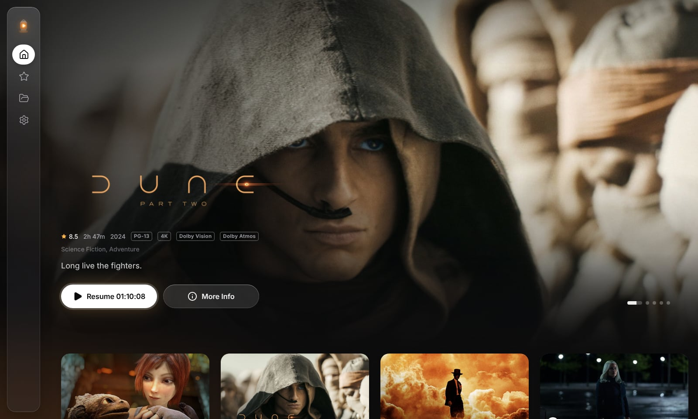

## Download (Windows 10 / 11)

**[⬇ Download MagicLanterns-Setup.exe](https://github.com/PushkarX-Code/MagicLanterns/releases/latest/download/MagicLanterns-Setup.exe)**, then run it.

Or install from PowerShell in one line:

```powershell
irm https://raw.githubusercontent.com/PushkarX-Code/MagicLanterns/main/install.ps1 | iex
```

This downloads the latest release and opens the installer. The app isn't code-signed yet, so Windows SmartScreen may say *"Windows protected your PC"*: click **More info → Run anyway**.

## Screenshots

Every screenshot is the running app. Artwork and details are real film data; the player is showing the open-licensed film *Sintel*.

**Home.** Recents, Recently Added, Picks of the Day
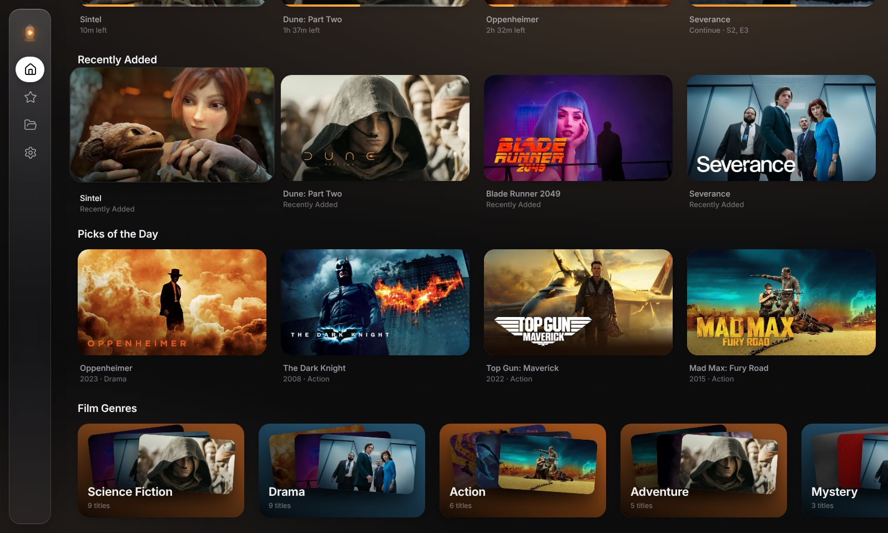

**Film Genres, Unwatched and Most Watched**
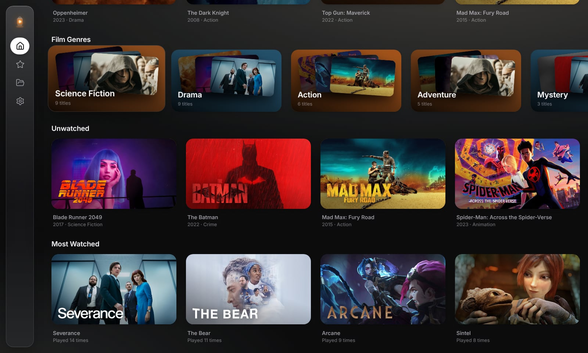

**Detail page** with ratings, formats, resume and watchlist
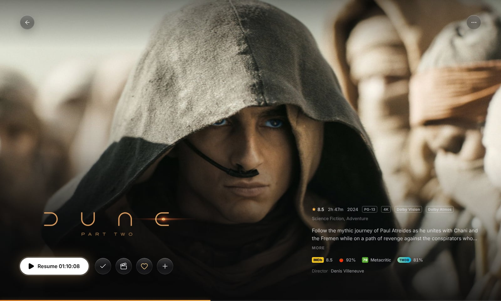

**Player**
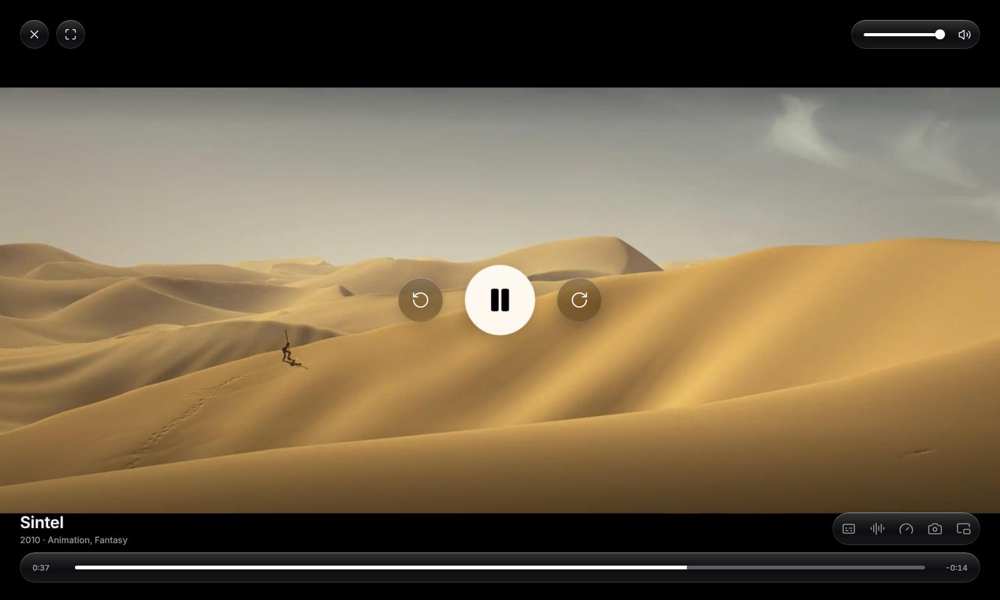

**Paused**
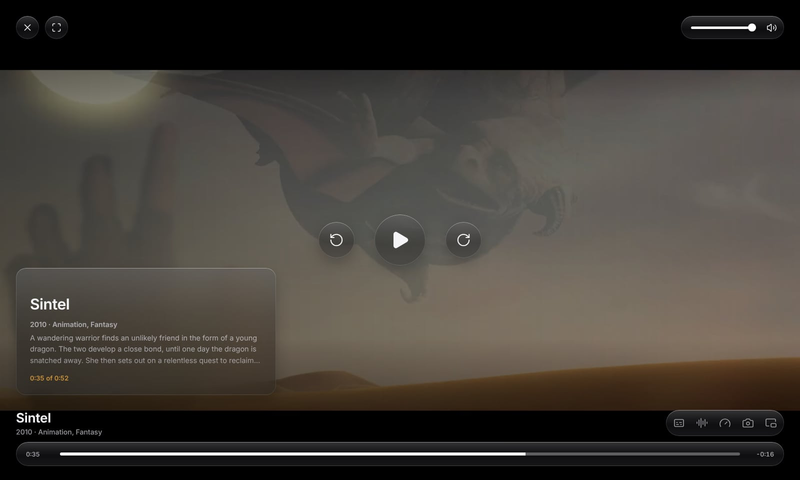

**Files.** List view, grouped by when files arrived
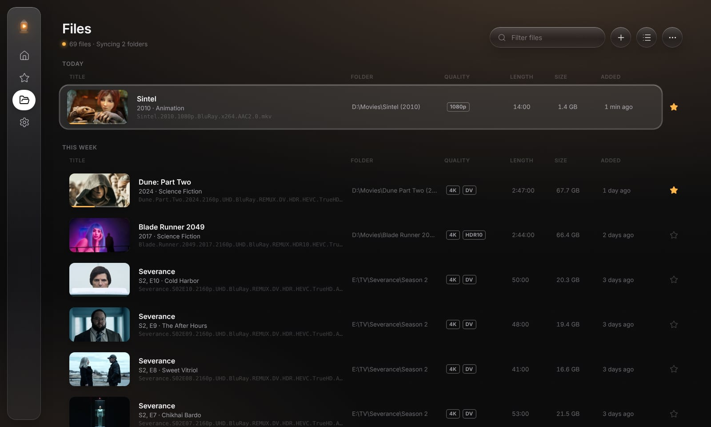

**Files.** Grid view
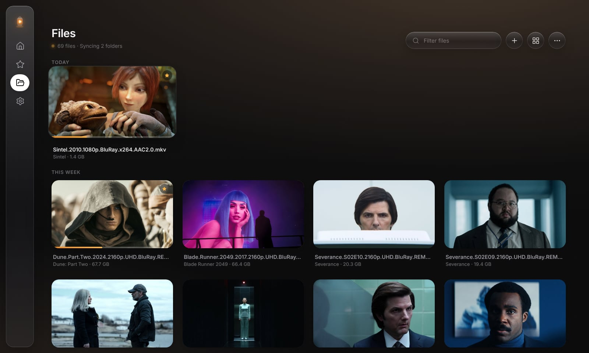

**Files.** The More menu: sort, select, starred, hide watched
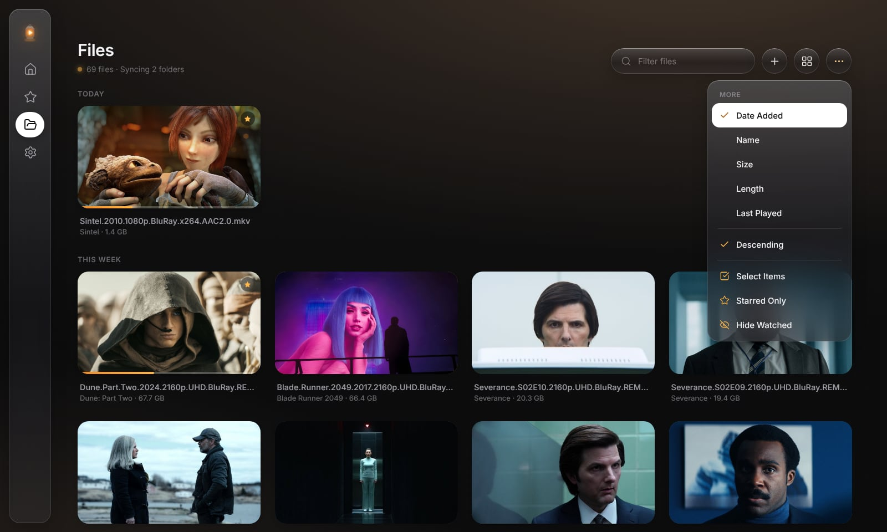

**Favorites**
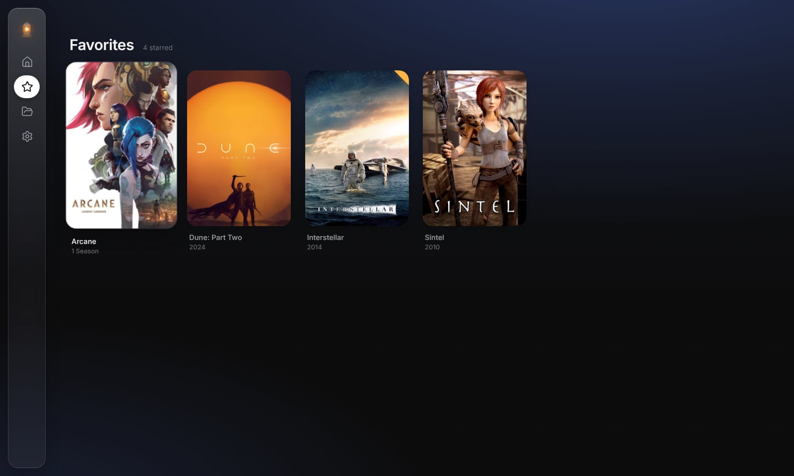

**Settings.** Video
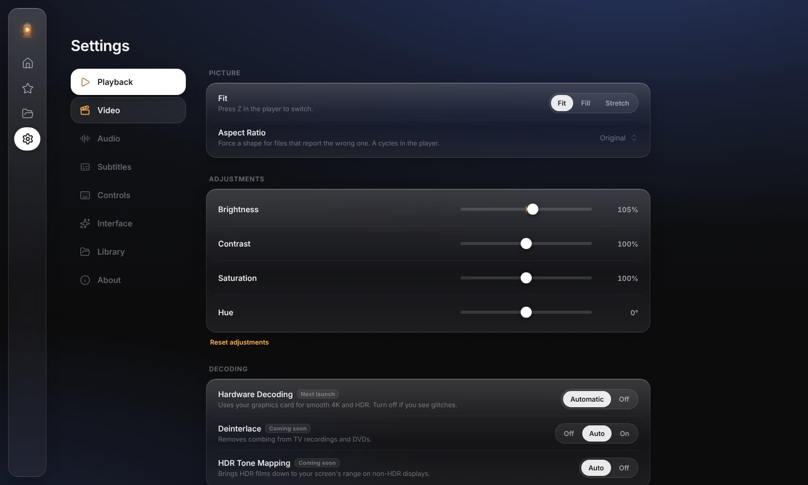

**Settings.** Audio, with the 10-band equalizer
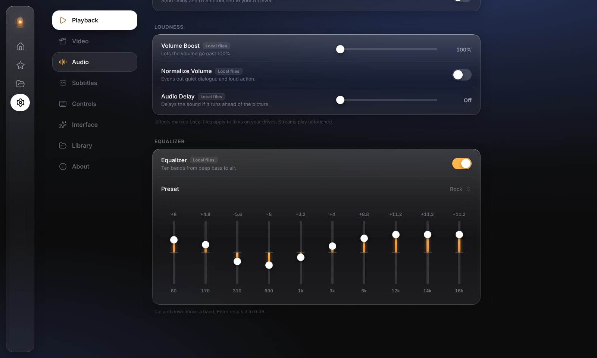

**Light theme**
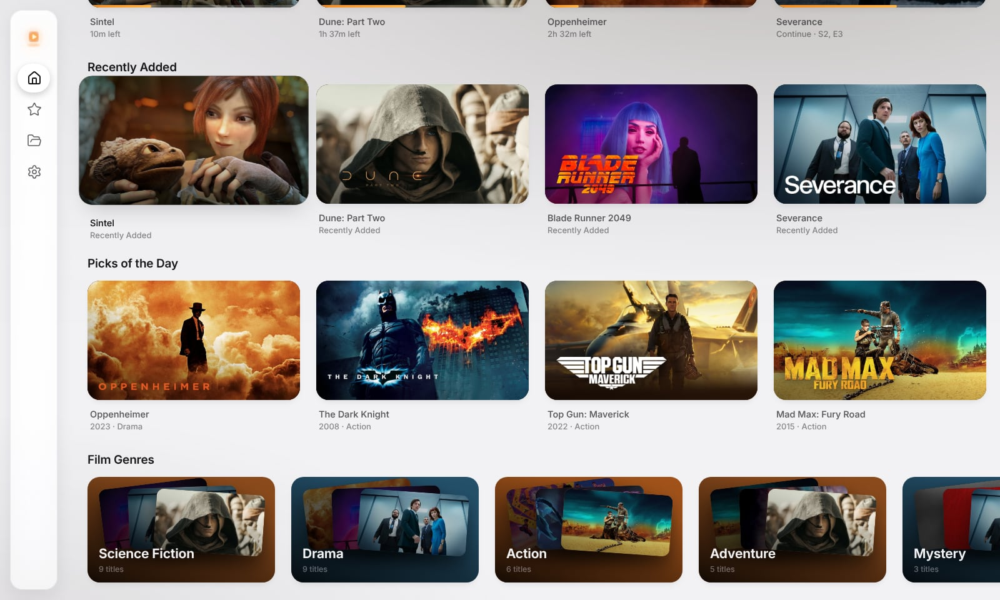

## What's in it

**Sections:** Home, Favorites, Files and Settings.

**Home** opens on a hero carousel, then: your recents (no heading, just the films), Recently Added, Picks of the Day (a fresh shuffle every day), Film Genres, Unwatched and Most Watched.

**Files** lists every file in your library folders, newest first.
- **+** adds a folder, adds single files, or opens a network stream (HTTP, HTTPS, HLS).
- The **view** button switches between Grid, List, Compact and Posters.
- **More** sorts by date added, name, size, length or last played, flips the order, selects several files at once (star, mark watched or unwatched, remove), and filters to starred or unwatched.

**Player**
- Resume (ask, always or never), repeat (off, one, all), autoplay next episode, speed from 0.25× to 4×.
- Fit, fill or stretch, forced aspect ratios, brightness, contrast, saturation and hue.
- 10-band equalizer with presets, volume boost to 200%, normalize, audio delay, stereo downmix and output device. These apply to files on your drives.
- Snapshots at full resolution (Shift+S), saved to `Pictures\Magic Lanterns`.
- Keep on top, start in full screen, pause when minimized, scroll wheel for volume or seeking.

**Settings** has eight tabs: Playback, Video, Audio, Subtitles, Controls, Interface, Library and About. Options that need the upcoming decoding engine are labelled *Coming soon* rather than pretending to work.

**Themes:** Default (warm dark that picks up the colours of what you're browsing), Dark (true black) and Light. Films always play on black.

**Motion:** every button, card and row sinks when pressed and springs back. Reduce Motion swaps this for gentle fades.

## Build from source

Requires [Node.js 20+](https://nodejs.org).

```bash
npm install
npm run dev
```

The first `npm install` downloads the desktop runtime (about 100 MB).

| Command | Does |
|---|---|
| `npm run dev` | Launch with hot reload |
| `npm run build` | Production bundle into `out/` |
| `npm run preview` | Run the production bundle |
| `npm run typecheck` | TypeScript check for main + renderer |
| `npm run icons` | Rebuild `build/icon.ico` and PNGs from `build/icon-src/*.svg` |
| `npm run dist` | Build the Windows installer into `release/` |

### Publishing a release

In GitHub, open **Actions → Release → Run workflow**, enter a version such as `v0.1.0`, and run it. It builds the installer on Windows and publishes it as a Release, which the download link and the PowerShell command above always point at. Pushing a tag like `v0.1.0` does the same.

### Metadata keys

Posters, banners and film details work out of the box. Live lookups for new files (Phase 3) use two free API keys that are built into the app at compile time and never shown in Settings:

1. Copy `.env.example` to `.env`.
2. Fill in `MAIN_VITE_TMDB_API_KEY` and `MAIN_VITE_OMDB_API_KEY`.
3. For release builds, add the same values as repository secrets named `TMDB_API_KEY` and `OMDB_API_KEY`.

`.env` is git-ignored, and the keys stay in the main process; the interface never sees them.

## Keyboard

| Where | Keys |
|---|---|
| Everywhere | Arrows move focus · Enter selects · Esc / Backspace goes back · `/` or Ctrl+F searches |
| Player | Space / K play · ← → skip by the seek step · ↑ ↓ volume · M mute · F full screen · `[` `]` `=` speed · S subtitles · Shift+S snapshot · Z fit · A aspect · L repeat · N next episode |
| Settings | ← → adjust a slider · Enter resets it · ↑ ↓ on an equalizer band |

The mouse works everywhere: hover focuses, click selects, the scrubber shows frame previews.

## Status

| Phase | What | State |
|---|---|---|
| 1 | Shell: design system, icon, splash, sidebar, Home, Detail, Player, motion, skeletons | Done |
| 1.5 | Home, Favorites, Files, full player controls, Settings, themes | Done |
| 2 | Library engine: scan, file probing, parsing, database, folder watching | Next |
| 3 | Metadata: live lookups, image cache, Fix Match | |
| 4 | Decoding engine: every format, real subtitles, passthrough | |
| 5 | Polish: onboarding, installer | |

Until Phase 2 the library is a fixed demo of 13 films and 4 series. Every title plays the *Sintel* trailer as a stand-in; drop any video file onto the player to watch your own.

See [PLAN.md](PLAN.md) for the architecture.

## Credits

This product uses the TMDB API but is not endorsed or certified by TMDB. *Sintel* © Blender Foundation, CC BY 3.0.

Made by Pushkar.
